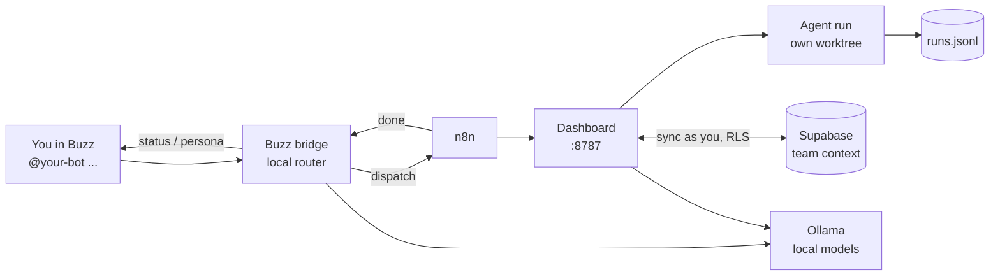

# Arunachala Operations Center

Run a small team's AI workforce from chat. Each teammate runs Arunachala on
their own Windows machine: a dashboard, a Buzz chat bot, local models and a
dispatcher that hands coding tasks to agents (Claude, Codex, Hermes). The team
shares its context - agent runs, AI call ledger, memory, task board - through
Supabase. Local models do the routine work; frontier models run only when a
task needs them, inside daily caps.

| Document | For |
|---|---|
| [SETUP.md](SETUP.md) | Step-by-step install, admin and teammate |
| [docs/USER_GUIDE.md](docs/USER_GUIDE.md) | Using it day to day, and how each part works |
| [docs/HLD.md](docs/HLD.md) | High-level design: components, flows, data model, security, costs |
| [docs/FRD.md](docs/FRD.md) | Functional requirements, acceptance criteria and status |
| [CLAUDE.md](CLAUDE.md) | Operating notes for agents working on this repo |

**Contents:** [At a glance](#at-a-glance) · [Onboarding](#1-onboarding) ·
[Setup](#2-setup-and-configuration) · [Infrastructure](#3-infrastructure) ·
[Using it](#4-using-it) · [Costs](#5-costs-and-tokens) ·
[Operations](#6-operations) · [Development](#7-development) ·
[Security](#8-security)

---

## At a glance



1. You mention your bot in Buzz. A **local** model decides what you want.
2. Status questions are answered from telemetry; questions go to a persona on
   a local model; tasks go to an agent in its own git worktree, with the
   team's relevant memories added to its prompt.
3. The agent commits on its branch (never pushes); the result comes back in
   your thread.
4. Runs, AI calls and memory are written locally first and copied to the
   team's Supabase tables every 30 seconds.

---

## 1. Onboarding

### 1.1 Admin - add a teammate (about 10 minutes)

| Step | Where | What |
|---|---|---|
| 1 | Supabase → **Talia** org → **Talia** project → Authentication → Users → **Add user** → *Create new user* | Email: their address with a `+arunachala` alias (e.g. `ravi+arunachala@example.com` - mail still reaches their inbox). Set a password, tick **Auto Confirm User**. Give them the password privately. |
| 2 | Supabase SQL editor | Add them to the team (SQL below). |
| 3 | Buzz relay host | `docker exec buzz-prod-relay-1 buzz-admin add-member --pubkey <their hex pubkey> --role member` |
| 4 | Send them | Supabase URL, publishable key (`sb_publishable_...`), `TEAM_ID`, Buzz channel id(s). None of these are secrets. |

```sql
insert into public.arunachala_team_members (team_id, user_id, display_name, buzz_pubkey, role)
select 'fc4a173d-e64a-4324-b26f-4ef786427e26', id, 'Ravi', '<their 64-hex Buzz pubkey>', 'member'
from auth.users where email = 'ravi+arunachala@example.com';
```

Why a separate `+arunachala` login: it keeps Arunachala apart from the other
apps that share the Talia project, and a dashboard-created user needs no
recovery email (Talia's recovery emails point at other apps).

### 1.2 Teammate - install (30-60 minutes, mostly downloads)

```powershell
winget install OpenJS.NodeJS.LTS Git.Git NSSM.NSSM Docker.DockerDesktop Ollama.Ollama
git clone https://github.com/tnmurthy/fuzzy-octo-eureka.git C:\tt-ai-stack\01_projects\active\arunachala-dashboard
cd C:\tt-ai-stack\01_projects\active\arunachala-dashboard
powershell -ExecutionPolicy Bypass -File .\install-teammate.ps1 -DryRun   # checks, changes nothing
powershell -ExecutionPolicy Bypass -File .\install-teammate.ps1           # elevated: installs
```

The installer pulls the local models, asks for your name, Buzz key, a unique
bot name and your Supabase login, saves the password to
`C:\tt-ai-stack\04_internal\secrets\arunachala-team.env` (never the project
folder), installs the three services and imports the n8n workflow. Then:

1. Open http://127.0.0.1:5678, create the n8n owner account, switch the
   **buzz-dispatch** workflow to **Active**.
2. In Buzz (mytestbed community) pick your bot from the `@` popup and send
   `@<your bot> is everything up?`

Full walkthrough and troubleshooting: [SETUP.md](SETUP.md).

---

## 2. Setup and configuration

Everything personal is in two gitignored files plus one secrets file - no
personal value is in the code.

| File | Holds | Required |
|---|---|---|
| `.env` (from `.env.example`) | `OPERATOR_NAME`, `OPERATOR_HOME`, Supabase URL / publishable key / email, `TEAM_ID`, `SECRETS_ENV_FILE` | `OPERATOR_HOME` |
| `buzz-bridge/.env` (from its `.env.example`) | `BUZZ_OPERATORS` (your Buzz key), `BUZZ_BOT_NAME`, `BUZZ_BOT_CHANNELS` | `BUZZ_OPERATORS` |
| `04_internal\secrets\arunachala-team.env` | `SUPABASE_PASSWORD` - named by `SECRETS_ENV_FILE` in `.env` | for team sync |

Team sync is on only when all five Supabase settings resolve (URL, key,
email, password, `TEAM_ID`); otherwise the install runs solo on local files.

| Optional setting | Default | Effect |
|---|---|---|
| `DISPATCH_LOCAL_FIRST` | `false` | `true`: claude requests try the local agent first; claude only if the repo's tests fail |
| `CLAUDE_MODEL` / `CLAUDE_MAX_TURNS` / `CLAUDE_LEAN` | `sonnet` / `40` / `true` | Model, turn cap and lean context for dispatched claude runs |
| `DISPATCH_MEMORY_CONTEXT` | `true` | Add the 3 most relevant team memories to each dispatch prompt |
| `PERSONA_MODEL` | `gemma3:4b` | Persona chat model; `qwen2.5:7b` only with a GPU |
| `MEMORY_EMBEDDINGS` | `true` | Memory search by meaning; `false` = keywords |
| `BUZZ_DIGEST` (bridge) | `false` | `true` on **one** bridge per team: weekly digest, Monday 09:00 IST |

All settings with comments: `.env.example`, `buzz-bridge/.env.example`.

---

## 3. Infrastructure

**On each teammate's machine**

| Component | Runs as | Port | Role |
|---|---|---|---|
| `ArunachalaDashboard` | NSSM service, LocalSystem | 127.0.0.1:8787 | UI, API, dispatch, persona chat, team sync, memory search |
| `ArunachalaBuzzBridge` | NSSM service, LocalSystem | 127.0.0.1:3100 (`/notify`) | Buzz bot: filter, route, reply, weekly digest |
| `ArunachalaTelemetry` | NSSM service, LocalSystem | - | Health probes and snapshots |
| n8n | Docker | 127.0.0.1:5678 | `buzz-dispatch` workflow: start run, poll every 10 s, notify |
| Ollama | User app + watchdog task | 11434 | `gemma3:4b`, `qwen2.5-coder:3b`, `nomic-embed-text` |
| Agent runs | git-bash, one per run | - | `orchestration/agent-dispatch.sh`, own worktree per run |

**Shared by the team**

| Service | Where | Role |
|---|---|---|
| Supabase | **Talia** project (`onsmkbwqucvbzggugmmn`) | `arunachala_*` tables: team, members, runs, AI calls, limits, memory, tasks - row-level security per team |
| Buzz relay | `buzz.mytestbed.tech` (Docker on the admin host, Cloudflare Tunnel) | Team chat |
| Cloudflare | Tunnel + Access | `team.mytestbed.tech` (dashboard, owner only) and the relay |

Why LocalSystem: a service logon as the user fails with Windows Hello-only
sign-in; `OPERATOR_HOME` gives agent runs the user's profile and CLI logins.
Design detail and diagrams: [docs/HLD.md](docs/HLD.md).

---

## 4. Using it

| You want to | Do this |
|---|---|
| Check that everything is up | `@<bot> is everything up?` |
| Ask a persona | `@<bot> ask the tech lead: should we cache this?` |
| Get code written | `@<bot> run claude in <repo>: <task>` - reply in the thread when done |
| See runs | Dashboard → **Agent Runs**, or `/api/runs?scope=team` |
| Plan work | Dashboard → **Kanban Board** (team board; create/move via `POST`/`PATCH /api/tasks`) |
| Find what the team knows | `/api/memory/search?q=...&scope=team` (ranked by meaning) |
| See what AI costs | Dashboard → **Costs** |

| Agent | Use it for |
|---|---|
| `claude` | Real code changes, migrations, security-relevant work |
| `codex` | A second builder on an independent task |
| `hermes` | Local, offline: drafts, summaries, small edits |
| `agy` | Read-only review (plan mode; name the files in the prompt) |
| `auto` | Local first, claude only if the repo's tests fail (repos with `npm test` or a `.arunachala-test` file) |
| `noop` | Testing the pipeline |

Details: [docs/USER_GUIDE.md](docs/USER_GUIDE.md).

---

## 5. Costs and tokens

| Lever | Effect (measured on a CPU-only i7) |
|---|---|
| Local routing, personas, embeddings | No per-token cost for the high-volume calls |
| Lean dispatch (`CLAUDE_LEAN`) | Context loaded per claude run 64k → 39k tokens (32k after trimming duplicate global rules) |
| `CLAUDE_MODEL=sonnet`, `CLAUDE_MAX_TURNS=40` | Routine runs off the most expensive model; no runaway runs |
| `auto` local-first | Claude runs only when the local attempt fails the repo's tests |
| Ledger | Every call (local and paid) with tokens, time and cost in `arunachala_ai_calls`; the Costs tab and weekly digest read it |
| Caps | Paid calls stop at 200/person and 1000/team per day, enforced by the database |

---

## 6. Operations

| Task | Command |
|---|---|
| Restart after a code or `.env` change | `Restart-Service ArunachalaDashboard -Force; Start-Service ArunachalaBuzzBridge` (elevated) |
| Bot silent? | `Get-Content logs\buzz-bridge.out.log -Tail 20` (mention not picked from the popup → `Skipped ...: bot not mentioned`) |
| Team sync failing? | `logs\server.err.log`: `team-store ... failed` names the reason (e.g. `invalid_credentials`) |
| A run's full output | `C:\tt-ai-stack\04_internal\agent-runs\<run id>.log` |
| Check an install | `.\install-teammate.ps1 -DryRun` |
| Seed the task board from `TASKS.md` | `node scripts/import-tasks.js` then `--apply` |

**Never kill the services' node PIDs** - NSSM restarts them and leaves
duplicates; restart the service instead. More symptoms: the troubleshooting
table in [SETUP.md](SETUP.md).

**Local database lock.** Every project's local Supabase stack is one shared
database; wrap resets and test suites so two agents don't collide:
`orchestration/db-lock.sh supabase db reset`, `orchestration/db-lock.sh npm test`
(lock `~/.agent-locks/supabase-local.lock`, waits up to `DB_LOCK_WAIT`
1800 s, breaks locks older than `DB_LOCK_STALE` 3600 s).

---

## 7. Development

| Path | What |
|---|---|
| `server.js` | Dashboard server (zero npm dependencies) |
| `index.html`, `dashboard.js`, `dashboard.css`, `team.html` | UI: Dashboard, Kanban, Agents, Infrastructure, Logs, Agent Runs, Costs |
| `telemetry-daemon.ps1` | Health probes and snapshots |
| `buzz-bridge/` | The Buzz bot |
| `orchestration/` | `agent-dispatch.sh` (worktrees, `auto`, claude usage), `db-lock.sh`, `runlog.mjs`, `claude-usage.mjs` |
| `team-store/` | Supabase sync: session, REST, runs, ledger, memory, tasks, costs |
| `memory-*.js`, `embeddings.js`, `dispatch-context.js`, `digest.js`, `load-env.js` | Memory, search, prompt context, digest, settings |
| `supabase/` | Migrations for `arunachala_*` and their DB checks |
| `n8n/`, `scripts/`, `install-teammate.ps1`, `docs/` | Workflow, one-off scripts, installer, documentation |

| Check | Command |
|---|---|
| All Node tests | `npm test` |
| Shared-table security checks (Docker) | `bash supabase/tests/run-local.sh` |
| A second copy for testing | `PORT=8799 node server.js` |

Work on a branch, open a PR to `main`; CI runs `npm test` and checks the
PowerShell scripts parse and stay ASCII. Commits follow Conventional Commits.

---

## 8. Security

- Secrets live only in gitignored `.env` files and `04_internal\secrets`; the
  Supabase key in `.env` is the publishable one.
- Each person signs in to Supabase as themselves; row-level security limits
  them to their team. Never put a `service_role` key on a laptop.
- The dashboard binds to 127.0.0.1; the public hostname sits behind
  Cloudflare Access plus an origin JWT check.
- The bridge obeys only its owner's Buzz keys; agents commit, never push.
- `apis.txt` (an old plaintext key file) is excluded in `.gitignore` as a
  guard rail - check `git status` before your first commit.
