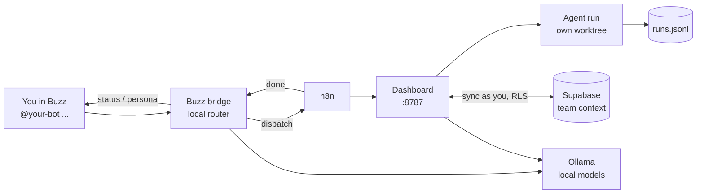

# Arunachala Operations Center

Run a small team's AI workforce from chat. Each teammate runs Arunachala on
their own Windows machine: a dashboard, a Buzz chat bot, local models and a
dispatcher that hands coding tasks to agents (Claude, Codex, Hermes). The
team shares its context - agent runs, AI call ledger, memory, task board -
through Supabase. Local models do the routine work; frontier models run only
when a task needs them, inside daily caps.

| Document | For |
|---|---|
| [SETUP.md](SETUP.md) | Installing it (admin steps + teammate steps) |
| [docs/USER_GUIDE.md](docs/USER_GUIDE.md) | Using it day to day, and how each part works |
| [docs/HLD.md](docs/HLD.md) | High-level design: components, flows, data model, security, costs |
| [docs/FRD.md](docs/FRD.md) | Functional requirements, acceptance criteria and status |
| [CLAUDE.md](CLAUDE.md) | Operating notes for agents working on this repo |

## At a glance



1. You mention your bot in Buzz. A **local** model decides what you want.
2. Status questions are answered from telemetry; questions go to a persona on
   a local model; tasks go to an agent in its own git worktree.
3. The agent commits on its branch (never pushes); the result comes back in
   your thread.
4. Runs, AI calls and memory are written locally first and copied to the
   team's Supabase tables every 30 seconds.

## Quick start

```powershell
git clone https://github.com/tnmurthy/fuzzy-octo-eureka.git C:\tt-ai-stack\01_projects\active\arunachala-dashboard
cd C:\tt-ai-stack\01_projects\active\arunachala-dashboard
powershell -ExecutionPolicy Bypass -File .\install-teammate.ps1 -DryRun   # check, changes nothing
powershell -ExecutionPolicy Bypass -File .\install-teammate.ps1           # elevated: install
```

Then in Buzz (mytestbed community), pick your bot from the `@` popup:
`@<your bot> is everything up?` - details in [SETUP.md](SETUP.md).

## Repository layout

| Path | What |
|---|---|
| `server.js` | Dashboard server (zero npm dependencies): UI, API, dispatch, persona chat |
| `index.html`, `dashboard.js`, `dashboard.css`, `team.html` | Dashboard UI (tabs: Dashboard, Kanban, Agents, Infrastructure, Logs, Agent Runs) |
| `telemetry-daemon.ps1` | Service probes and snapshots (`telemetry.json`, `history.json`) |
| `buzz-bridge/` | The Buzz bot: protocol, routing, replies, pending-dispatch store |
| `orchestration/` | `agent-dispatch.sh` (runs, worktrees, `auto` local-first), `db-lock.sh`, `runlog.mjs` |
| `team-store/` | Supabase sync: session, REST, runs, AI ledger, memory, tasks |
| `memory-engine.js`, `memory-search.js`, `embeddings.js` | Drisyon memory and search by meaning |
| `supabase/` | Migrations for the shared `arunachala_*` tables and their DB checks |
| `n8n/` | The `buzz-dispatch` workflow |
| `install-teammate.ps1`, `.env.example` | Per-person install and settings |
| `docs/` | HLD, FRD, user guide |

## Agents you can dispatch to

| Agent | Runs | Use it for |
|---|---|---|
| `claude` | `claude -p ... --permission-mode acceptEdits` | Lead work, migrations, anything security-relevant |
| `codex` | `codex exec -C <worktree> -s workspace-write` | A second builder on an independent task |
| `agy` | `agy --mode plan --prompt=...` | Read-only review; name the files in the prompt |
| `hermes` | `hermes --in <worktree> -z ...` | Local, offline: drafts, summaries, small edits |
| `auto` | hermes, then the repo's tests, claude only if they fail | Small tasks in repos with tests (`DISPATCH_LOCAL_FIRST=true`) |
| `noop` | Prints the prompt | Testing the pipeline |

From a shell, without chat:

```bash
orchestration/agent-dispatch.sh codex C:/tt-ai-stack/01_projects/active/bov chore/search-path task.md
```

Each run appends a start and an end line to
`C:\tt-ai-stack\04_internal\agent-runs\runs.jsonl` (`AGENT_RUNS_DIR` to
override) and writes the agent's output to `<run-id>.log` beside it.
`AGENT_TIMEOUT` (default 3600 s) bounds a run. Every prompt is prefixed with
the rules: stay in the worktree, commit on the branch, never push to main,
wrap the shared local database in the lock.

### The local database lock

Every project's local Supabase stack is one shared database, so two agents
resetting it or running suites against it at once break each other's runs:

```bash
orchestration/db-lock.sh supabase db reset
orchestration/db-lock.sh npm test
```

The lock is `~/.agent-locks/supabase-local.lock`. A second caller waits up to
`DB_LOCK_WAIT` (1800 s); a lock older than `DB_LOCK_STALE` (3600 s) is broken.

## Running and testing

| Task | Command |
|---|---|
| Restart after a code or `.env` change | `Restart-Service ArunachalaDashboard -Force; Start-Service ArunachalaBuzzBridge` (elevated) |
| A second copy for testing | `PORT=8799 node server.js` |
| All Node tests (141) | `npm test` |
| Shared-table security checks (11, needs Docker) | `bash supabase/tests/run-local.sh` |

`telemetry.json`, `history.json` and everything under `logs/` are runtime
output and git-ignored.

## Security note

Secrets live only in the gitignored `.env` files - never in code or commits.
The Supabase key in `.env` is the publishable one; each person signs in as
themselves and row-level security limits them to their team. This project
once lived next to `apis.txt`, a plaintext file of live keys; it is excluded
by name in `.gitignore` as a guard rail, not a substitute for keeping it out
of the folder. Check `git status` before your first commit.
