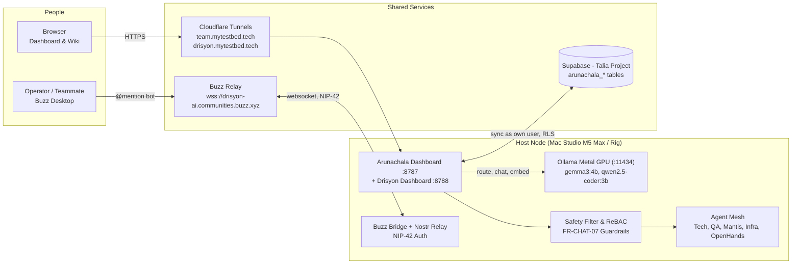
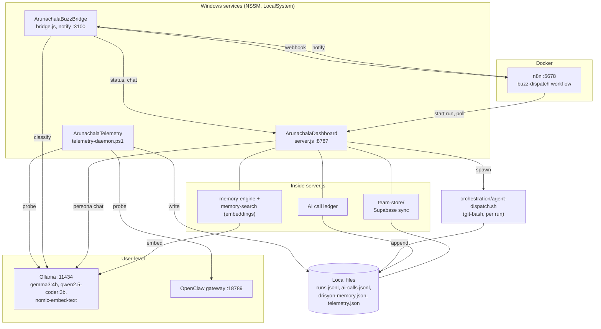
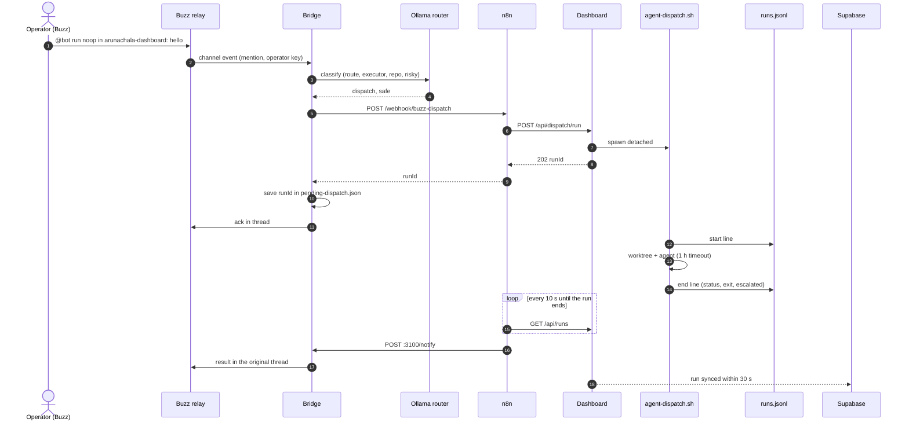
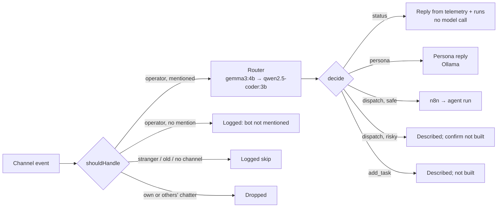
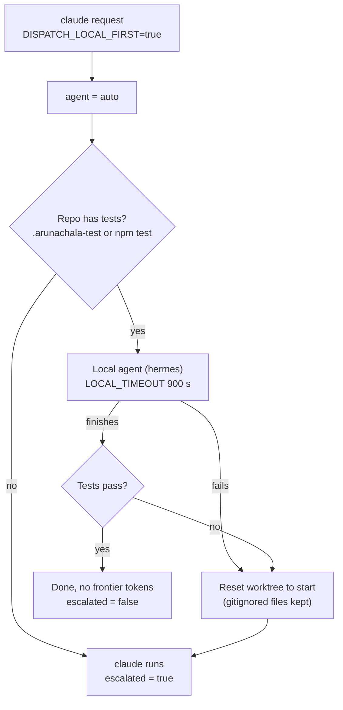
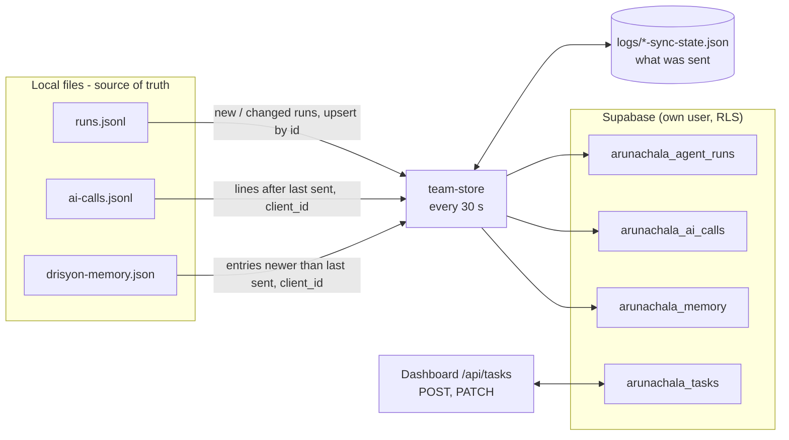
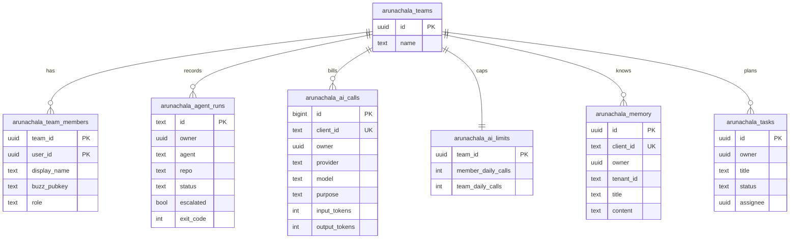
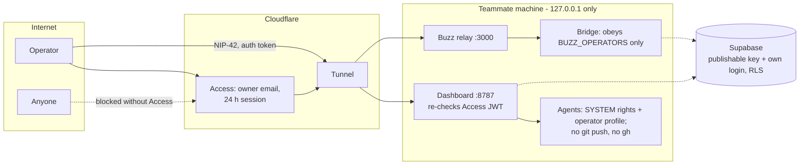

# Arunachala Operations Center - High-Level Design

Arunachala lets a small team run an AI workforce from chat and unified dashboards:
the host environment (Apple Silicon Mac Studio with Metal GPU acceleration, or Windows rigs)
runs the operations dashboard, Drisyon agency workspace, a Buzz Nostr chat bridge, local Ollama models,
and an autonomous dispatcher that hands coding tasks to agents, while the team shares context
(agent runs, AI call ledger, 4-tier memory, task board) through Supabase and local storage.
Local models do high-volume work; frontier models run only when a task needs escalation.

As of November 2026. Setup: [`SETUP.md`](../SETUP.md). Working notes for agents
editing this repo: [`CLAUDE.md`](../CLAUDE.md). Agency Wiki: [`docs/WIKI.md`](WIKI.md).

---

## 1. Context

| Concern | Choice | Why |
|---|---|---|
| Where it runs | Every teammate runs their own install | Own keys and logins; no shared server to maintain |
| What is shared | Supabase tables, scoped by team with row-level security | One place for context, no service key on laptops |
| Which model | Local Ollama first, frontier on escalation | Routing, chat and search are high-volume and cheap locally |
| Chat surface | Buzz (Nostr relay) | Already the team's channel; signed, authenticated messages |

---

## 2. Components on one machine

| Component | Runtime | Responsibility | Key files |
|---|---|---|---|
| Dashboard | NSSM, Node, 127.0.0.1:8787 | UI and every `/api/*` route; spawns runs; team sync; memory search | `server.js`, `team-store/`, `memory-*.js`, `embeddings.js` |
| Buzz bridge | NSSM, Node, notify on 127.0.0.1:3100 | Bot on the relay: filter, route, reply in thread | `buzz-bridge/` |
| Telemetry | NSSM, PowerShell | Service probes, CPU, agent stats to JSON snapshots | `telemetry-daemon.ps1` |
| n8n | Docker, 127.0.0.1:5678 | Webhook → start run → poll every 10 s → notify | `n8n/buzz-dispatch-workflow.json` |
| Dispatcher | git-bash child, one per run | Worktree per run, agent call, run log, `auto` escalation | `orchestration/agent-dispatch.sh` |
| Ollama | User tray app + watchdog task | Routing, personas, embeddings | `ollama-watchdog.ps1` |

All three services run as LocalSystem. Per-person values come from `.env`
(`OPERATOR_HOME` gives agent runs the operator's profile and CLI logins).

---

## 3. Key flows

### 3.1 Buzz message to agent run and back

### 3.2 Message routing

### 3.3 Local-first dispatch (`auto`)

### 3.4 Team sync (outbox pattern)

Offline or refused: the state is not advanced, so the same rows go on the
next tick, and the outage is logged once. Resends are no-ops (`id` /
`client_id` unique). Team sync is off unless all five `SUPABASE_*` /
`TEAM_ID` settings are present; a solo install runs on local files alone.

---

## 4. Data model (Supabase, shared)

| Rule (row-level security) | Effect |
|---|---|
| Read | Members read their own team's rows only |
| Write | Rows are inserted as yourself (`owner = auth.uid()`); runs and memory change only by their owner |
| Tasks | A shared board: any member creates and moves tasks |
| Membership | Only team owners add or remove members |
| AI caps | A trigger rejects paid calls past 200 per member or 1000 per team per UTC day; `ollama` calls are exempt |

Migrations: `supabase/migrations/`. Checks (11, Postgres in Docker):
`bash supabase/tests/run-local.sh`.

---

## 5. Security and trust boundaries

| Boundary | Control |
|---|---|
| Public dashboard | Cloudflare Access at the edge plus origin JWT check (`access-auth.js`), fails closed |
| Public relay | NIP-42 auth, restricted writes, auth token required |
| Bridge commands | Only the owner's Buzz pubkeys (`BUZZ_OPERATORS`, no default) |
| Dispatch API | Loopback only; agent allow-list; repo must be a plain directory name; 10 KB body caps on task routes |
| Agents | Run in their own worktree; commit, never push or merge; claude has a tool allow-list |
| Supabase | No service key on laptops; RLS per team; `security definer` helpers not callable by `anon` |
| Secrets | `.env` files are gitignored; the installer types the Supabase password hidden |

Known gaps: agents run with SYSTEM rights while using the operator's profile
(acceptable on a single-user machine); `POST /api/buzz/events` is an open
webhook nothing calls and should be deleted; ReBAC gates only `/api/ping`.

---

## 6. Cost controls

| Lever | Where | Effect |
|---|---|---|
| Local routing, personas, embeddings | Ollama | No per-token cost for the high-volume calls |
| Local-first dispatch | `DISPATCH_LOCAL_FIRST`, `agent-dispatch.sh auto` | Claude runs only when the local attempt fails the repo's tests |
| Ledger of every call | `logs/ai-calls.jsonl` → `arunachala_ai_calls` | Tokens, time and purpose per call, per person |
| Hard daily caps | `arunachala_ai_limits` + trigger | Paid calls stop at the cap; owners change the limits |
| Right-sized persona model | `PERSONA_MODEL` | gemma3:4b on CPU (6.5 tok/s); qwen2.5:7b only with a GPU (3.1 tok/s on CPU) |

---

## 7. API surface (`server.js`)

| Route | Purpose |
|---|---|
| `GET /api/telemetry`, `/api/history` | Service health snapshot and CPU/latency series |
| `GET /api/config` | Operator name and persona model for the UI |
| `GET /api/runs[?scope=team]` | Agent runs, local or the whole team's |
| `POST /api/dispatch/run` | Start an agent run (n8n calls this) |
| `GET /api/tasks`, `POST /api/tasks`, `PATCH /api/tasks/<id>` | Task board: team board in Supabase, else read-only `TASKS.md` |
| `GET /api/memory/search?q=[&scope=team]` | Memory search by meaning (embeddings), keyword fallback |
| `POST /api/memory/store`, `POST /api/team/dispatch` | Add memory / operator directives |
| `POST /api/agent/chat` | Persona chat on Ollama |
| `GET /api/openclaw`, `/api/models`, `/api/ping` | OpenClaw usage, Ollama models, handshake test |

---

## 8. Open items

| Item | Next step |
|---|---|
| Risky dispatches and add-task only described | Build a confirm step in the bridge |
| Bridge listens to one relay (mytestbed) | Multi-relay only if drisyon-ai becomes the team's channel |
| Memory search threshold (0.5) is loose on a small store | Tune once there are more memories |
| `codex` / `hermes` untested as live dispatch targets | One real run each |
| n8n per person | Replace with a poller inside the bridge to drop a component |
