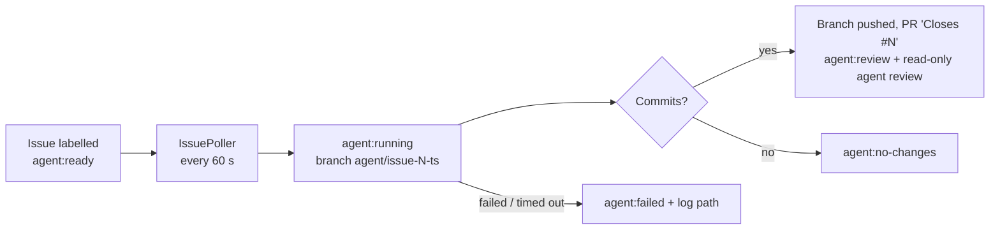

# Arunachala - User Guide

How to use Arunachala day to day, and what happens behind each action.
Install first: [`SETUP.md`](../SETUP.md). Design: [`HLD.md`](HLD.md).
Requirements: [`FRD.md`](FRD.md).

---

## 1. What you can do

| You want to | Do this | What answers |
|---|---|---|
| Check that everything is up | The dashboard, or `pm2 ls` | Status built from telemetry - no model call |
| See what agents did today | The **Agent Runs** tab | Run history |
| Think a problem through | Persona chat in the dashboard | A persona on a local model |
| Get code written | Open a GitHub issue and label it `agent:ready` (§2) | An agent in its own worktree; a PR when done |
| Plan work with the team | The task board (API today, see §5) | Shared board in Supabase |
| Find something the team knows | `/api/memory/search?q=...&scope=team` | Memory ranked by meaning |
| See what AI is costing | The ledger (§7) | Every call: model, tokens, time |

---

## 2. Handing work over: the GitHub issue queue

1. Open an issue in a repo the poller watches (`POLLER_REPOS`). Put the task
   in the title and body.
2. Add the label `agent:ready`. Optionally add `agent:claude`, `agent:codex`,
   `agent:hermes`, `agent:noop` or `agent:auto` to pick the agent; otherwise
   `POLLER_DEFAULT_AGENT` (claude) runs. Use `agent:hermes` for docs and
   drafts, claude for code.
3. Within a minute the poller relabels the issue `agent:running`.



Only issues opened by `POLLER_AUTHORS` (default: the repo owner) run, and at
most `POLLER_MAX_CONCURRENT` (2) runs go at once across all repos; reviews
count. Text the safety filter refuses needs the label `agent:confirmed`.
After opening a PR the poller starts a second, read-only run on the same
branch (`POLLER_REVIEW_AGENT`: claude, noop or off) and posts its verdict and
findings as a PR comment.

---

## 3. Dispatching an agent

A dispatch hands one task to one agent. With the issue queue, the poller
dispatches for you: label the issue and a PR arrives when the run ends.

| Agent | Runs | Use it for |
|---|---|---|
| `claude` | Claude Code, your login | Real code changes, migrations, security-relevant work |
| `codex` | OpenAI Codex, your login | A second builder on an independent task |
| `hermes` | Local model, offline | Drafts, summaries, small private edits |
| `agy` | Antigravity, plan mode | Read-only review (name the files in the prompt) |
| `noop` | Echoes the prompt | Testing the pipeline |
| `auto` | Local first, claude if tests fail | Saving tokens on small tasks (§4) |

**What the agent may do:** work only in its own git worktree beside the repo
(`<repo>--<branch>`) and commit on its branch; it never pushes or merges. The
poller pushes the branch and opens the PR; you review and merge. Runs time out
after one hour (`AGENT_TIMEOUT`).

**Where to look**

| What | Where |
|---|---|
| Run list | Dashboard → **Agent Runs**, or `/api/runs` (`?scope=team` for everyone) |
| Full agent output | `04_internal\agent-runs\<run id>.log` |
| The agent's work | The worktree folder and its branch |

---

## 4. Saving tokens: local first

Turn on `DISPATCH_LOCAL_FIRST=true` in `.env` and restart
`ArunachalaDashboard`. Every `claude` dispatch then runs as `auto`:

1. The local agent (hermes) tries the task.
2. The repo's own tests decide: the one-line command in `.arunachala-test` at
   the repo root, else `npm test` if `package.json` has a test script.
3. Tests pass: done, no frontier tokens spent. Tests fail, the local agent
   fails, or the repo has no tests: the worktree is reset and claude runs.

To opt a repo in, commit a `.arunachala-test` file, for example:

```
npm test -- --run
```

The run record says whether it escalated (`escalated: true/false`), so the
team can see how often local was enough.

---

## 5. The shared task board

When team sync is on, the **Kanban Board** tab shows the team's board from
Supabase; otherwise it shows `04_internal/TASKS.md` (read-only). Creating and
moving tasks is API-only for now:

```powershell
# create (status: backlog | in_progress | done; project and link optional)
Invoke-RestMethod -Method Post http://127.0.0.1:8787/api/tasks -ContentType application/json `
  -Body '{"title":"Write the onboarding video","project":"docs"}'

# move
Invoke-RestMethod -Method Patch http://127.0.0.1:8787/api/tasks/<task id> -ContentType application/json `
  -Body '{"status":"in_progress"}'
```

Seed the board once from `TASKS.md`: `node scripts/import-tasks.js` (preview),
then `node scripts/import-tasks.js --apply`. Already-present titles are skipped.

---

## 6. Team memory

Anything stored in memory (directives, notes, `POST /api/memory/store`) syncs
to the team within 30 seconds. Search ranks by meaning, not keywords:

```
http://127.0.0.1:8787/api/memory/search?q=how do we deploy&scope=team
```

The response's `ranker` is `embeddings` normally, or `keywords` if Ollama is
down. Leave out `scope=team` to search only your machine.

---

## 7. Costs

Every model call is written to `logs/ai-calls.jsonl` and synced to
`arunachala_ai_calls`. Local calls (`provider = ollama`) are free and never
count towards the caps; paid calls stop at 200 per person and 1000 per team
per day (owners change `arunachala_ai_limits`).

Useful queries (Supabase SQL editor):

```sql
-- this week by person, provider and purpose
select m.display_name, c.provider, c.purpose, count(*) calls,
       sum(c.input_tokens + c.output_tokens) tokens
from arunachala_ai_calls c
join arunachala_team_members m on m.user_id = c.owner and m.team_id = c.team_id
where c.created_at > now() - interval '7 days'
group by 1, 2, 3 order by tokens desc;

-- how often local-first was enough
select escalated, count(*) from arunachala_agent_runs where agent = 'auto' group by 1;
```

---

## 8. How it all works

**Your machine runs these services** (`ArunachalaTelemetry`,
`ArunachalaDashboard`, `IssuePoller`), plus Ollama:

- The **telemetry service** checks every few seconds that Ollama, OpenClaw
  and Watchtower answer, and writes a snapshot the dashboard reads.
- The **dashboard** (http://127.0.0.1:8787) serves the UI and the API, starts
  agent runs, answers persona chats on a local model, searches memory, and
  copies your runs, AI calls and memory to the team every 30 seconds.
- The **issue poller** (`orchestration/issue-poller.js`) checks GitHub every
  60 seconds for issues labelled `agent:ready`, starts a run through the
  dashboard's `/api/dispatch/run`, and on finish pushes the branch and opens
  the PR.

**Your files stay the source of truth.** Runs, AI calls and memory are written
locally first and copied up afterwards, so nothing is lost when the internet
or Supabase is down; the copy catches up on the next tick.

**The team sees what you share, nothing else.** You sign in to Supabase as
yourself. The database lets you read your team's rows and change only your
own (tasks are the exception: anyone moves any task).

---

## 9. Everyday operations

| Task | Command (elevated PowerShell where noted) |
|---|---|
| Restart everything | `pm2 restart all --update-env && pm2 save` (Windows: `Restart-Service ArunachalaDashboard -Force`, elevated) |
| Did a setting change apply? | Restart `ArunachalaDashboard` - it reads `.env` at start |
| Issue not picked up? | `pm2 logs IssuePoller --lines 50` |
| Team sync working? | `logs\server.err.log` - `team-store ... failed` lines; silence means fine |
| Check the install | `.\install-teammate.ps1 -DryRun` |

More symptoms and fixes: the troubleshooting table in [`SETUP.md`](../SETUP.md).
